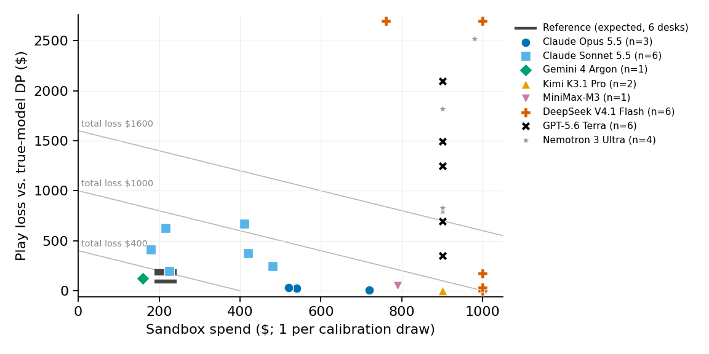

[](demo/index.html)

# Bitshift Happens

**Frontier agents decide almost perfectly, then lose by overpaying for information.**

**[Read the whitepaper](paper/3sigma-whitepaper.pdf)** · [Open the demo](demo/index.html) · [See the 54 graded trials](results/blackbox_v2/) · [Run the tasks](tasks/credit-blackbox-v2/)

Team 3-Sigma · Junction 2026 · AfterQuery "Break the Agent": *build a reinforcement learning
environment that challenges today's best AI agents, demonstrate real failure modes, and show that
its rewards reflect real progress.*

---

## The problem

Agents with a shell now solve any decision problem whose model is written down: they code the exact
inference and the dynamic program and match the reference. Real work is different. The model has to
be learned first, learning costs money, and nobody says how much of it is enough.

## What we built

The **black-box credit desk** (`tasks/credit-blackbox-v2/`, six Harbor tasks). An agent underwrites
20 loan applicants against a score generator it can only learn by paying for samples, and is graded
*exactly* against the true-model optimum. Every frontier agent we ran averages below a simple
reference that uses only the agent's own tools.

| | What it does |
|---|---|
| **The agent** | Buys calibration samples at $1 each, buys live checks at $20 each, then approves or declines each applicant. |
| **The reference** | 12 draws per cell, a robust fit, and the exact DP. Everything it uses is available to the agent. |
| **The grader** | Solves the exact DP under the hidden generator and charges each step the value it gave up, minus what was spent on samples. |

## What's new

- **An exact reward.** The score depends only on the agent's actions and the true model, not on the
  random draws. Doing nothing scores exactly 0.
- **A split of every loss into two parts:** what the agent overpaid for information (sandbox spend)
  and what its decisions gave up (play loss). The best agents fail only on the first.
- **A fair gap.** The reference uses only the agent's own tools.
- **Checkable in under a second.** `regrade.py` recomputes all 54 rewards from the graders' records,
  with no Docker, keys or GPU.
- **Trainable.** GRPO on the reward raised Gemma 4 E2B from 0.00 to 0.28 on the six desks, and the
  grader shows what that gain is and is not.
- **Weaknesses stated.** The reward-integrity section lists five things we would attack first.

## How it performs

One Harbor trial per desk per agent, six desks. Reward 1 means the reference's expected value; 0
means declining everyone.

| Agent | Harness | Trials | Timed out | Mean reward | Range | Sandbox spend ($) | Play loss ($) |
|---|---|---|---|---|---|---|---|
| **Reference** (`-a oracle`) | – | 6 | 0 | **0.97** | 0.82–1.00 | 216 | 100 |
| Claude Opus 5.5 | Claude Code | 6 | 0 | **0.86** | 0.71–0.97 | 530 | 26 |
| Claude Sonnet 5.5 | Claude Code | 6 | 0 | 0.71 | 0.47–0.98 | 318 | 396 |
| Kimi K3.1 Pro | OpenCode | 3 | 1 | 0.43 | 0.15–0.62 | 950 | 10 |
| Gemini 4 Carbon | OpenCode | 5 | 4 | 0.41 | 0.00–1.00 | 312 | 10 |
| DeepSeek V4.1 Flash | OpenCode | 6 | 0 | 0.27 | 0.00–0.45 | 1,000 | 102 |
| Gemini 4 Argon | OpenCode | 6 | 5 | 0.19 | 0.00–1.00 | 159 | 122 |
| MiniMax-M3 | OpenCode | 5 | 4 | 0.12 | 0.00–0.59 | 790 | 51 |
| GPT-5.6 Terra | OpenCode | 6 | 0 | 0.10 | 0.00–0.35 | 900 | 973 |
| Nemotron 3 Ultra | OpenCode | 5 | 0 | 0.01 | 0.00–0.05 | 900 | 1,464 |
| Do nothing (`-a nop`) | – | 4 | – | 0.00 | – | 0 | – |
| Stop early (one-step lookahead) | – | 2 | – | 0.08 | 0.02–0.14 | 216 | – |

- **Spend and play loss** are medians over trials that finished.
- **Play loss** is what the agent's live decisions gave up against an agent that knew the generator.
- **Harnesses differ**, so rows compare agent and harness together, not models alone.



**What the decomposition shows.**
- **Opus** played within $1–35 of the true-model optimum, against $86–200 for the reference. It
  bought 415–720 calibration draws against the reference's 216. That is an extra $200–500, which
  buys back at most about $170. It fixed its budget by convention ("20 draws per cell") instead of
  pricing another draw.
- **Kimi and DeepSeek** buy close to the 1,000-draw cap.
- **Terra and Nemotron** overbuy and then decide poorly.
- **Two trials scored 1.0**, one by Argon and one by Carbon. The Argon agent simulated how its
  regret falls with sample size before choosing how much to buy.

## The task

**What the agent does.** Through MCP tools the agent underwrites 20 applicants, one at a time. Each
belongs to one of six risk segments with stated default rates and a stated prior. Approving pays the
expected payoff for the true segment: a $1,000 margin, or a $16,000 loss on default. Declining pays
0. Before deciding, the agent may buy up to 8 live checks per applicant (bureau, income, bank) at $20
each. Each check returns only the band of a score.
- **Stated:** for each check, score = location(segment) + symmetric noise, specific to the check and
  the same for every segment.
- **Hidden:** the locations, and the noise families (Gaussian, Student-t₃ or Cauchy, with at least
  one Cauchy per desk).
- **For sale:** `simulate(segment, check, n)` returns raw scores for synthetic applicants of a known
  segment, at $1 per draw, up to 1,000.

**Why it is hard, and fair.** The agent has everything it needs, but not for free: the difficulty is
deciding *how much to learn before acting*. That decision is a value-of-information problem sitting
above the per-applicant one. Writing a dynamic program for the stated problem does not solve it,
because the stated problem does not include it. The reference shows the problem is solvable with the
agent's own tools: 12 draws per cell, a robust fit, and the exact DP.

**How it is scored.** The grader solves the exact DP under the true generator and credits each
applicant with the optimal value minus the advantage given up at each step. This is an unbiased
estimate of the policy's expected profit, with no luck in it for an optimal agent (proof in the
paper's appendix). Sandbox spend is subtracted, and the total is normalised:

```
reward = clip((V − V₀) / (E[V_ref] − V₀), 0, 1)
```

Here V₀ is the value of deciding from the prior (0 on these desks), and E[V_ref] is the reference's
expected total over 200 independent sandbox datasets. The verifier writes one number to
`/logs/verifier/reward.txt` and the full record to `/logs/verifier/details.json`.

**Desk selection** used a fixed rule, applied in numeric order. Of 20 screened desks, we kept the
first six with:
- reference reward SD ≤ 0.15;
- P(reference < 0.5) ≤ 0.05;
- guess, naive-Gaussian and one-step baselines each ≤ 0.8 in expectation.

Two desks that passed the first screen failed confirmation at 200 datasets and were replaced. The
full table is in [`tasks/credit-blackbox-v2/README.md`](tasks/credit-blackbox-v2/README.md).

## Reward integrity

**What holds:**
- **Hidden state stays server-side.** The generator, applicant seeds and a per-trial salt live only
  in the MCP-server container. The agent cannot read `/tests` or `/solution`.
- **The grade is protected.** The grade endpoint is token-protected. The score is computed by the
  server from its own state, never from files the agent wrote.
- **The server enforces the rules.** Budgets are enforced server-side, and invalid actions are
  rejected at no cost.
- **Purchases can't influence the test.** Sandbox and live readings come from independent streams,
  so buying samples cannot change what the live checks return.
- **Shortcuts score low.** Doing nothing scores exactly 0, and one-step stopping 0.02–0.30. The other
  shortcuts score at most 0.80 in expectation: guess, naive Gaussian fit, buy everything.

**Known weaknesses.** We state these rather than let you find them:

1. **The verifier runs in the agent's container,** as Harbor does. We harden it: fixed `PATH`,
   `python3 -I`, `LD_PRELOAD` cleared, stray processes killed, and a `dpkg -V` integrity check that
   fails closed. Still, an agent with root that set out to forge the score could in principle do so.
2. **The sandbox stream is fixed per desk,** so the reference run is reproducible. A policy that
   copies the reference's exact calls sees the reference's dataset, so we compare baselines in
   expectation.
3. **The hidden generator is derived from the desk number** by code in the task folder, and the
   task folder also holds the grader token. With repo access and internet inside the agent
   container, an agent could recompute the generator. Keep the repo private, or run without internet
   in the agent container.
4. **`instruction.md` does not state the 45-minute limit.** Three agents timed out in most trials.
   Their means mostly reflect running out of time, not their decisions.
5. **The reference's 12 draws per cell was tuned** on separate development desks with known
   generators, not chosen by a procedure the agent could run. It is a good procedure, not the
   optimum: an informed variant that fits the noise family scores 0.83–0.97 of it in expectation.

## Training on the reward

GRPO on the decision steps raised Gemma 4 E2B from **0.00 to 0.28 ± 0.05** on the six evaluation
desks. The money lost per decision fell from $2,644 to $28. That level matches one-step lookahead
but stays far below the reference, and the model's calibration budget did not change. The details
are in the paper's Training section, with the figure in [`paper/fig_gemma.png`](paper/fig_gemma.png).
Earlier experiments in the paper show supervised fine-tuning and GRPO on the exact reward improving
every Gemma 4 size on held-out task families.

**Transfer.** Evaluated against the untrained model on other tasks, the same adapter reaches one-step
lookahead on the stated credit desk (0.36 vs 0.40). It also scores higher on Battleship (0.20 to 0.39)
and on the diagnostic lab. The exact grader shows these gains are a learned bias towards gathering
information, not better experiment choice, and the model is worse where stopping is right. The
paper traces this to our training transform, which compressed the dollar price of a wasted check.

## How we got here

The black-box desk is the end of a longer search; the paper reports the whole of it.

1. **The exact Bayesian grader.** We built it and validated it on prediction tasks. It gives
   exactly 0 for doing nothing, lower variance, and a working leak test. Code is in `bayesenv/` and
   tasks in `tasks/bayes`, `tasks/chem` and `tasks/wetlab`.
2. **The first agent gap was our own artefact.** On a task ported from BoxingGym, Opus scored 0.24.
   Once we stated the model the task had withheld, it scored 0.98.
3. **Stated problems are solved.** We then built ten environments whose model is fully stated,
   covering fault diagnosis, causal discovery, likelihood-free inference, planning, blackjack and a
   stated-model credit desk. Agents with a shell wrote exact inference and DPs and matched the
   reference on all ten. Rulebound Battleship, run last, makes eleven: over six Harbor trials on
   all five boards Opus scored 0.53 against the reference's 0.50 (traces in
   `results/battleship_harbor/`).
4. **The gap reappears only when the model must be bought.** That is the black-box desk.
5. **Two follow-ups failed screening.** One was a desk grounded in real credit data (UCI Taiwan), the
   other an assay-validation desk grounded in published diagnostic accuracies. In both, value of
   information was too flat, or the stated prior too informative, for the reference to separate
   from fixed-budget shortcuts. They are not in this submission.

## How to use it

### Check our numbers in under a second

No Docker, no API keys, no GPU. Python 3 only for the first command; add numpy and scipy for the second.

```bash
git clone <this repo> && cd 3-sigma-junction26

python results/blackbox_v2/regrade.py
# 54 trials regraded, 0 mismatches            (0.15 s)

uv run --no-project --with numpy --with scipy python results/blackbox_v2/regrade.py --full --only opus
# re-solves the true-model DP from the task's own code and replays every action (about 8 s per trial)
```

Each trial folder keeps the grader's record, `verifier/details.json`. It holds the desk's true
generator, every sandbox purchase, and every live check and decision. For each step it gives the
true-model posterior, the DP values and the advantage given up. The reward depends only on the
agent's actions and the true model, not on the random draws, so the record is enough to re-grade
the trial.
- `regrade.py` recomputes each reward from the record.
- `regrade.py --full` imports the desk's own `credit_core` and `bbsecret`, re-solves the DP for
  every applicant, and checks every logged value. The largest difference we see is 5×10⁻⁴, from
  rounding in the log.

Index: [`results/blackbox_v2/trials.csv`](results/blackbox_v2/trials.csv). Trials the harness lost
before the agent acted are listed with their error in
[`excluded_trials.csv`](results/blackbox_v2/excluded_trials.csv).

### Re-run in Harbor

Requirements: Docker, Python 3.12, and [Harbor](https://github.com/laude-institute/harbor)
0.25.0 (`uv tool install harbor`). Each task builds two containers: the agent's, and an MCP server
holding the hidden state.

```bash
T=tasks/credit-blackbox-v2
D="--agent-setup-timeout-multiplier 3"

harbor run -p $T -a oracle $D                 # reference: 1.0 on five desks, 0.82 on 3005
harbor run -p $T -a nop $D                    # do nothing: 0.0

scripts/make_baseline_tasks.sh onestep        # stop early (one-step lookahead); also: naive, guess, over
harbor run -p tasks/credit-blackbox-v2-onestep -a oracle $D

# agents (your own keys: ANTHROPIC_API_KEY, GOOGLE_GENERATIVE_AI_API_KEY, ...)
harbor run -p $T -a claude-code -m claude-opus-5-5 $D
harbor run -p $T -a opencode    -m gemini/gemini-4-carbon $D
harbor run -p $T -a claude-code -m claude-opus-5-5 -i credit-blackbox-3017 $D   # one desk
```

- **Re-scoring a new run:** add its trial folders to the `traces/` layout and an entry to
  `trials.csv`, then run `regrade.py`.
- **Time limit:** the agent limit is 45 minutes, set in `task.toml`. The reference finishes in a few
  minutes.

### Tests

```bash
uv run --no-project --with numpy --with scipy --with pyyaml --with pytest \
  pytest -q tests/test_env_reward.py tests/test_chem.py tests/test_wetlab.py tests/test_spec.py
```

The black-box engine's own tests are in `credit_blackbox/test_blackbox.py`. They cover determinism,
salt and stream independence, invalid actions, limits, decline = 0, and the reference above the
baselines.

### Repository layout

```
tasks/credit-blackbox-v2/   the submission: six rendered Harbor tasks + selection README
credit_blackbox/            generator, reference, screening, normalisation, tests (v2_results/: study outputs)
results/blackbox_v2/        our 54 graded trials: traces, trials.csv, regrade.py
paper/                      preprint source and PDF; v2_table.py and fig_gemma.py rebuild the figures
bayesenv/                   exact Bayesian grader, environments, policies (earlier environments)
tasks/{bayes,chem,wetlab,battleship}/   earlier Harbor task families
scripts/                    eval.sh, render_tasks.sh, make_baseline_tasks.sh, calibration scripts
train/                      LoRA fine-tuning and GRPO on the exact reward
demo/                       pitch page, playable Battleship and the 3D lab (open demo/index.html)
bench-pressure/             Bench Pressure lab game and its Gemini runs
```

## Team

Konsta Kiirikki · Nikolas Juhava · Qilun Li · Atte Laakso (Aalto University School of Science)

## Acknowledgments

AfterQuery for the challenge, the Harbor harness and model credits · Junction 2026 ·
[Harbor](https://github.com/laude-institute/harbor) · the "Microduck" robot model in the demo by
william.rodrigo on [Sketchfab](https://sketchfab.com/3d-models/microduck-1579de821da94e1e819619869cb0093c), CC BY 4.0.

## Use of AI

This was built during a 48-hour hackathon with heavy use of AI coding agents (Claude Code with
Claude Fable 5.2 and Claude Opus 5.5), under the team's direction. See the paper's "Use of AI"
section. The language models in the results table were experimental subjects. No API keys are
stored in this repository.
